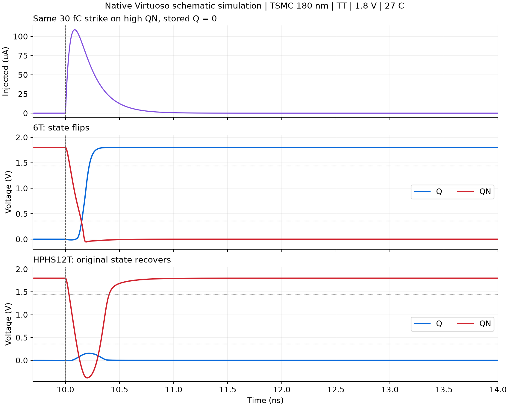

# 抗辐照 SRAM 课程设计

基于 Cadence Virtuoso 的抗辐照 SRAM 单元与 4×4 阵列课程设计，包含电路实现、仿真验证、AI 辅助开发过程及阶段报告。

## 当前进展

已完成单元原理图与前仿真阶段：建立 6T 基准单元和 HPHS12T 单元，验证读写、保持及单节点扰动响应。4×4 阵列和系统性能优化将在后续阶段开展。

本项目采用 tsmc18rf 180 nm 工艺、1.8 V 供电。功能测试覆盖 TT、FF、SS 工艺角；扰动扫描采用 TT、27 ℃，覆盖两种存储状态和各内部节点。在本次 30 fC 扰动扫描中，HPHS12T 的 8 种组合均恢复，6T 的 4 种组合中有 2 种恢复。HPHS12T 在 45 fC 及以上仍存在失效条件，详细结果见报告。



## 报告与工程入口

- [阶段设计报告](开发过程记录.md)：设计过程、AI 辅助方法、关键截图和结果分析。
- [复现说明](docs/复现说明.md)：查看原理图、重新分析已有波形和重新运行仿真的方法。
- [Virtuoso 工程库](cadence/rh_sram_lib)：6T、HPHS12T 的原理图与符号，以及四个测试电路。
- [完整结果表](artifacts/results/stage1_checks.csv)：82 组测试的条件和结果。
- [原生测试电路核验结果](artifacts/results/native_testbench_checks.json)：直接使用 Virtuoso 导出网表的四组仿真。

## 目录说明

| 路径 | 内容 |
| --- | --- |
| `cadence/` | 本项目创建的 OpenAccess 工程库与库配置示例 |
| `design/` | 晶体管定义、测试用例、SKILL 文件、Spectre 网表和激励 |
| `scripts/` | 原理图生成、仿真运行、数据检查和绘图脚本 |
| `artifacts/screenshots/` | Virtuoso、ViVA 及环境关键截图 |
| `artifacts/figures/` | 由实际仿真数据生成的图表 |
| `artifacts/results/` | 全部测试的数值波形及 CSV、JSON 汇总 |
| `artifacts/netlists/` | Virtuoso 实际导出的网表与一致性检查结果 |
| `artifacts/iterations/v0/` | 初版尺寸与代表性失败结果 |
| `references/`、`materials/` | 论文和课程学习资料索引 |

## 重新分析已有结果

使用 Python 3.12 安装依赖后，可在仓库根目录运行：

```sh
python -m pip install -r requirements.txt
python scripts/check_all_cases.py
python scripts/finalize_stage1.py
```

分析已有数据不需要启动虚拟机。82 组测试中有 14 组扰动后发生状态翻转，因此检查脚本输出 `CHECKED 82 PASSED 68`；这些翻转是记录的电路响应。四组原生测试分别复核功能及 30 fC 代表性扰动结果。

## 仿真条件与范围

两种单元使用相同的工艺、供电、温度、位线负载和电流模型，但晶体管数量与总沟道宽度不同，尚未完成等面积、等功耗比较。当前结果属于原理图前仿真，未包含版图寄生、完整电压与温度扫描、失配、多节点同时扰动或实际粒子辐照试验。

仓库保存本次设计生成的工程、代码和结果。VMware 镜像、软件安装包、PDK 模型、许可证、登录凭据及第三方论文和教程原件保留在本地环境中；运行新仿真时需要另行准备课程工具和工艺环境。
