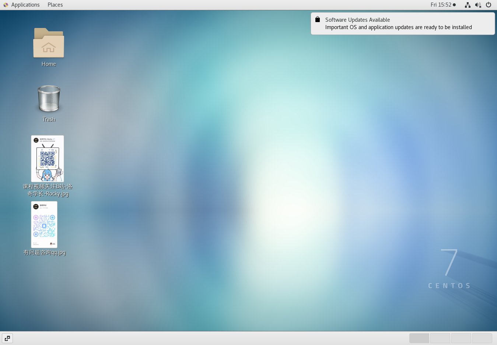
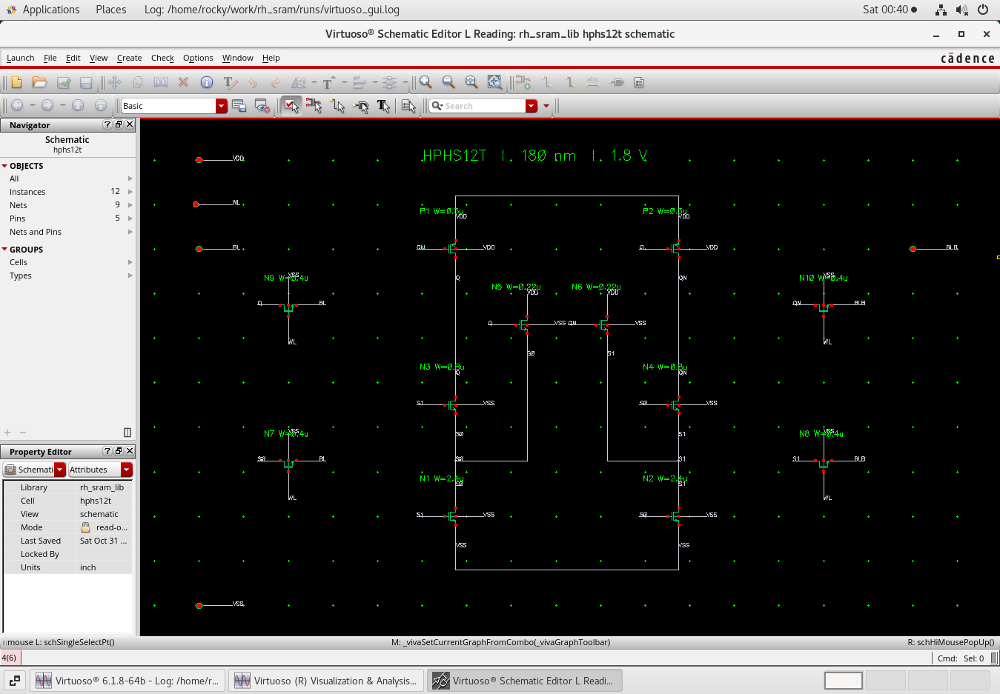
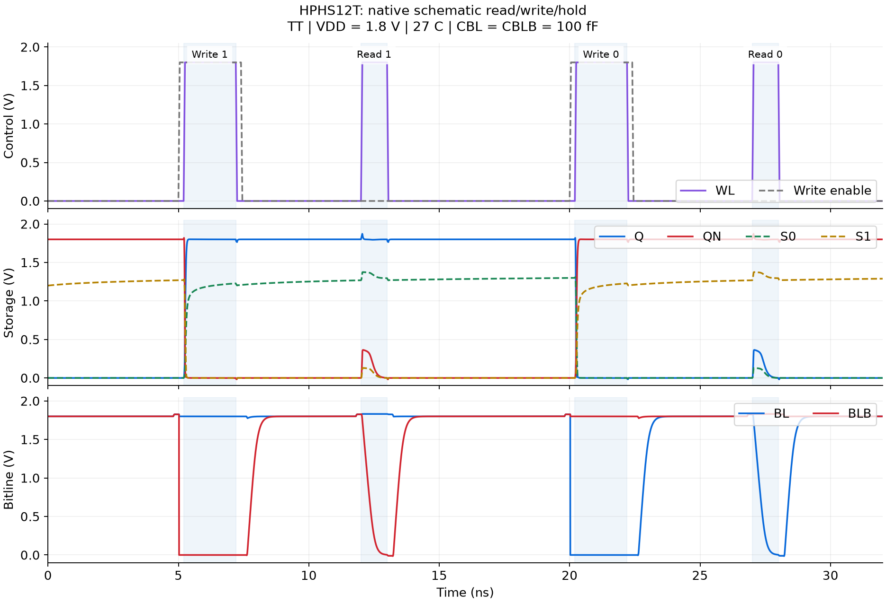
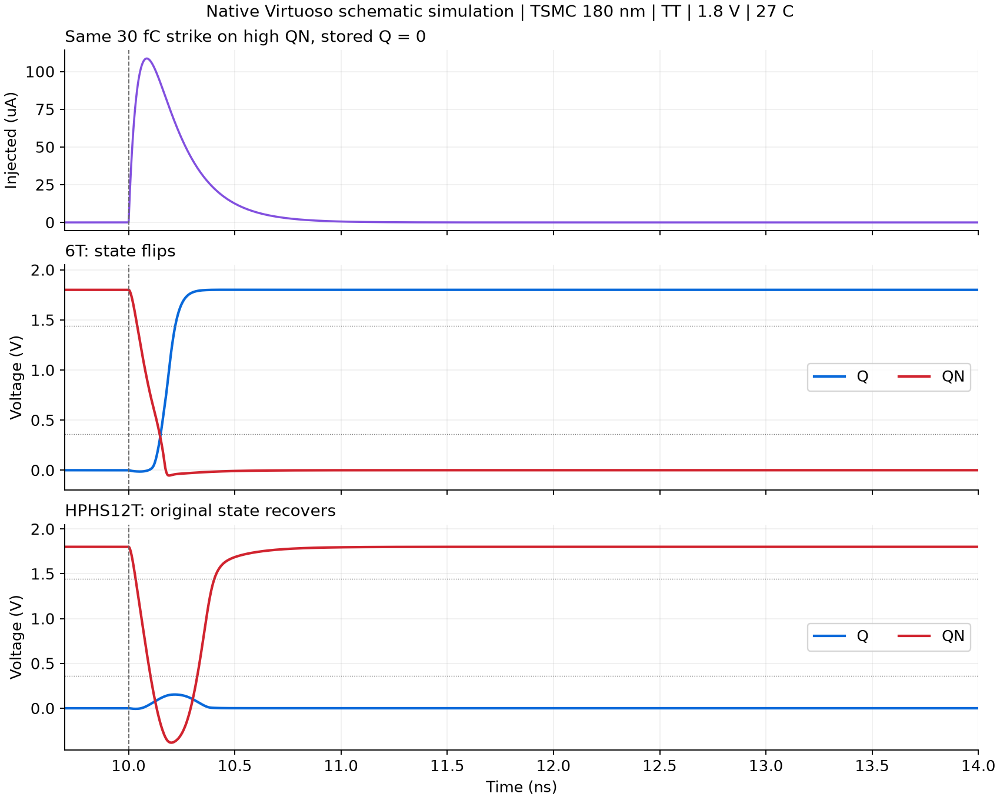
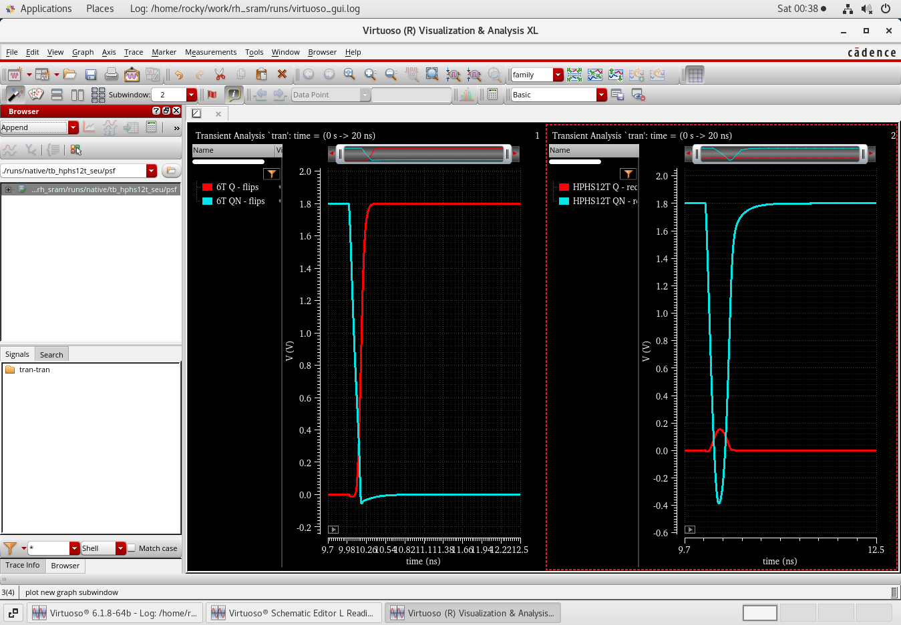

# 抗辐照 SRAM 单元设计与仿真阶段报告

## 一、设计目标

本课程要求在 Virtuoso 中设计抗辐照 SRAM 单元，将单个存储单元扩展为 4×4 阵列，并使用 AI 辅助优化性能。本阶段我先完成单个存储单元的设计与仿真，主要包括搭建开发环境、建立 6T 基准单元和 HPHS12T 抗辐照单元，以及验证读写、保持和单节点扰动后的恢复情况。

在设计过程中，我使用 AI 辅助梳理参考资料、编写原理图与仿真脚本、分析波形和调整器件尺寸，并通过 Virtuoso 和 Spectre 的实际运行结果检查设计是否成立。

## 二、环境搭建与资料学习2026-09-26

使用 VMware 启动 Linux 虚拟机，配置了 4 核 CPU 和 8 GB 内存，搭建 Virtuoso IC618 与 Spectre 仿真环境。随后建立 SSH 连接，便于在虚拟机中管理工程和执行批量仿真，同时使用图形界面查看原理图及波形。

图 1　虚拟机启动后的 Linux 桌面

结合课程提供的 SRAM 实验教程、读写时序资料、双指数电流源说明及参考论文，学习存储单元的基本结构和测试方法。本次设计采用 tsmc18rf 工艺库中的 0.18 μm 核心器件，供电电压为 1.8 V。正式设计 SRAM 前，我先在 TT 工艺角、27 ℃ 条件下运行 CMOS 反相器瞬态仿真，确认模型和仿真工具能够正常工作。

## 三、存储单元设计2026-10-10

### 3.1 结构选择

首先建立常规 6T SRAM，作为后续比较的基准。6T 单元由交叉耦合反相器和两个访问晶体管组成，通过字线 WL 控制单元与位线 BL、BLB 之间的数据传输。

抗辐照单元参考课程提供的 [HPHS12T 论文](https://doi.org/10.1016/j.microrel.2022.114885)，由 2 个 PMOS 和 10 个 NMOS 组成。除主存储节点 Q、QN 外，该结构还设置了辅助节点 S0、S1，通过反馈支路参与扰动后的状态恢复。原论文采用 55 nm 工艺和 1.2 V 供电，因此我根据现有 180 nm 工艺重新设置尺寸，并通过仿真调整参数。

### 3.2 原理图建立与尺寸设置

借助 AI 编写原理图生成脚本，在 Virtuoso 中建立了 6T 和 HPHS12T 的原理图及符号，并分别建立功能测试电路与扰动测试电路。2026 年 10 月 31 日，我完成器件端口、连接关系和尺寸核对，将 Virtuoso 实际导出的网表与设计定义逐项比较。两个单元及四个测试电路均通过原理图检查。

图 2　HPHS12T 单元原理图。同名网络在电气上相连，Q、QN 为主存储节点，S0、S1 为辅助节点。

全部存储晶体管的沟道长度均为 0.18 μm，当前采用的宽度如下。

| 器件组 | 6T 宽度（μm） | HPHS12T 宽度（μm） |
| --- | ---: | ---: |
| P1、P2 | 0.30 | 0.30 |
| N1、N2 | 0.80 | 2.40 |
| N3、N4 | 0.40，访问管 | 0.80，保持支路 |
| N5、N6 | — | 0.22 |
| N7～N10 | — | 0.40，访问管 |

以上尺寸用于原理图前仿真，源漏扩散参数采用估计值，尚未进行版图寄生提取。

## 四、功能仿真与扰动测试2026-10-17

### 4.1 读写与保持验证

我为两种单元设置相同的供电电压、温度和位线负载，每根位线的负载电容均为 100 fF。测试按照“写入 1—保持—读取 1—写入 0—保持—读取 0”的顺序进行，并在读取前对位线预充电。通过观察 Q、QN 的电平和 BL、BLB 的电压差，判断写入、保持及读取是否正确。

在 1.8 V、27 ℃ 条件下，两种单元均通过 TT、FF、SS 三个工艺角的功能测试。写入后，Q、QN 能够保持对应状态；读取结束后，存储状态没有发生翻转。HPHS12T 的辅助高电平约为 1.2～1.3 V，主存储状态仍由 Q、QN 判断。

图 3　HPHS12T 在 TT 工艺角下的功能仿真波形，依次展示写 1、读 1、写 0 和读 0。

### 4.2 单节点扰动的设置

使用双指数电流脉冲模拟单粒子效应引起的瞬态电流，上升时间常数为 50 ps，衰减时间常数为 164 ps。脉冲按照目标电荷量归一化，并通过电流积分检查实际注入电荷。

测试时先向单元写入指定数据，在 10 ns 时对选定节点施加扰动，并在 18 ns 检查 Q、QN 是否恢复到原状态。低电平和高电平的判断阈值分别为 0.36 V 和 1.44 V。扰动测试统一采用 TT 工艺角、1.8 V 供电和 27 ℃，分别覆盖存 0、存 1以及各内部节点，注入电荷设置为 10、20、30、45、60 和 90 fC。

### 4.3 初版问题与尺寸调整

初版 HPHS12T 虽然能够正常读写，但在部分 90 fC 扰动下仍会发生翻转。我结合 Q、QN、S0、S1 的波形分析恢复过程，并在 AI 辅助下尝试增强 N1、N2 的下拉保持能力，减弱 N5、N6 的反馈充电作用。

调整后，初版出现翻转的该项正向扰动能够恢复。我随后继续检查两种存储状态和全部内部节点，确认较强扰动仍可能使高电平 Q 或 QN 失去原状态，因此将这些失效情况保留在结果中。

### 4.4 扰动测试结果

下表统计每个电荷量下能够恢复的测试数量。6T 覆盖 2 个内部节点和 2 种存储状态，共 4 种组合；HPHS12T 覆盖 4 个内部节点和 2 种存储状态，共 8 种组合。

| 注入电荷 | 6T 恢复数量／测试数量 | HPHS12T 恢复数量／测试数量 |
| --- | ---: | ---: |
| 10 fC | 4／4 | 8／8 |
| 20 fC | 4／4 | 8／8 |
| 30 fC | 2／4 | 8／8 |
| 45 fC | 2／4 | 6／8 |
| 60 fC | 2／4 | 6／8 |
| 90 fC | 2／4 | 6／8 |

以存储 Q=0、向高电平 QN 注入 30 fC 电荷为例，6T 单元最终翻转为 Q=1；HPHS12T 虽然出现瞬态电压变化，但随后恢复到 Q≈0 V、QN≈1.8 V。两次仿真的实际注入电荷分别约为 30.0015 fC 和 30.0006 fC。

图 4　相同扰动条件下，6T 发生状态翻转，HPHS12T 恢复原来的存储状态。图中曲线由实际 Spectre 仿真数据绘制。

图 5　在 ViVA 中查看两种单元的扰动响应，左侧为 6T，右侧为 HPHS12T。

本阶段共完成 82 组测试，包括 6 组功能测试、4 组零电荷对照和 72 组非零扰动测试。其中 14 组在扰动后发生状态翻转，其余满足对应的功能或恢复条件。另外，我用 Virtuoso 实际导出的四个测试电路网表完成独立仿真，复核了功能结果及 30 fC 代表性扰动结果。

## 五、AI 辅助开发的使用过程

这次开发主要将 AI 用于三个方面：结合参考资料梳理电路结构，辅助编写原理图生成和批量仿真脚本，以及根据波形提出器件尺寸调整方案。在初版扰动测试失败后，我以实际仿真波形为依据重新调整参数，再用相同测试条件检查调整效果。

为核对脚本生成的电路，我检查了 Virtuoso 中的原理图，并比较实际导出网表中的器件连接和尺寸。结果分析同时覆盖成功恢复与发生翻转的情况，报告中的判断均以实际仿真数据为依据。

## 六、阶段小结与后续计划

本阶段我完成了 6T 基准单元和 HPHS12T 抗辐照单元的原理图设计，验证了读写与保持功能，并建立单节点电流扰动测试。当前 HPHS12T 在 30 fC 条件下的 8 种节点与状态组合均能恢复，表现出相对于当前 6T 基准的恢复能力改善；在 45 fC 及以上，部分高电平节点扰动仍会造成翻转。

两种单元采用相同工艺、供电、温度、位线负载和扰动模型，但器件数量与总沟道宽度不同，本阶段尚未进行等面积或等功耗比较。上述结果属于电路级前仿真，不能直接等同于实际粒子辐照试验结果，也不能据离散电荷扫描点给出精确临界电荷。

后续我将在当前单元基础上搭建 4×4 阵列，并进一步使用 AI 辅助比较和优化延迟、功耗及稳定性。版图、DRC/LVS、寄生后仿、SNM、失配及多节点同时扰动等内容尚未完成，将根据后续设计进展继续补充。
